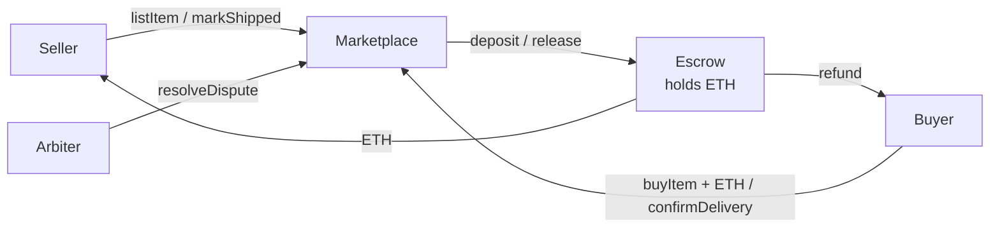
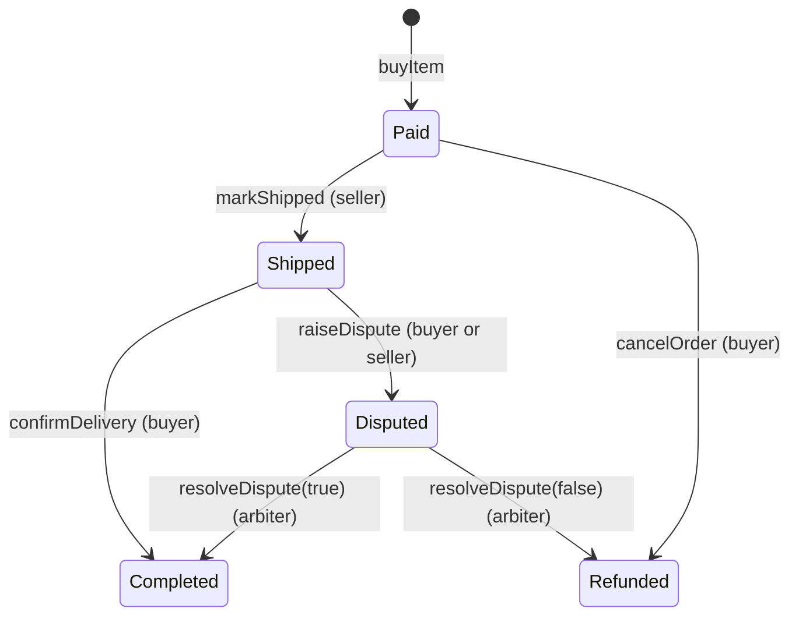
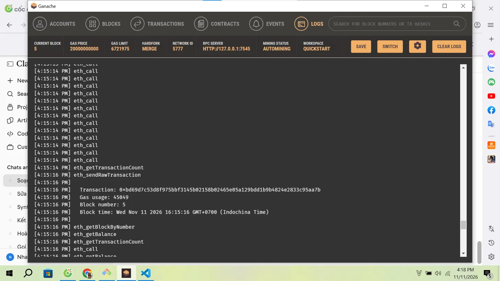
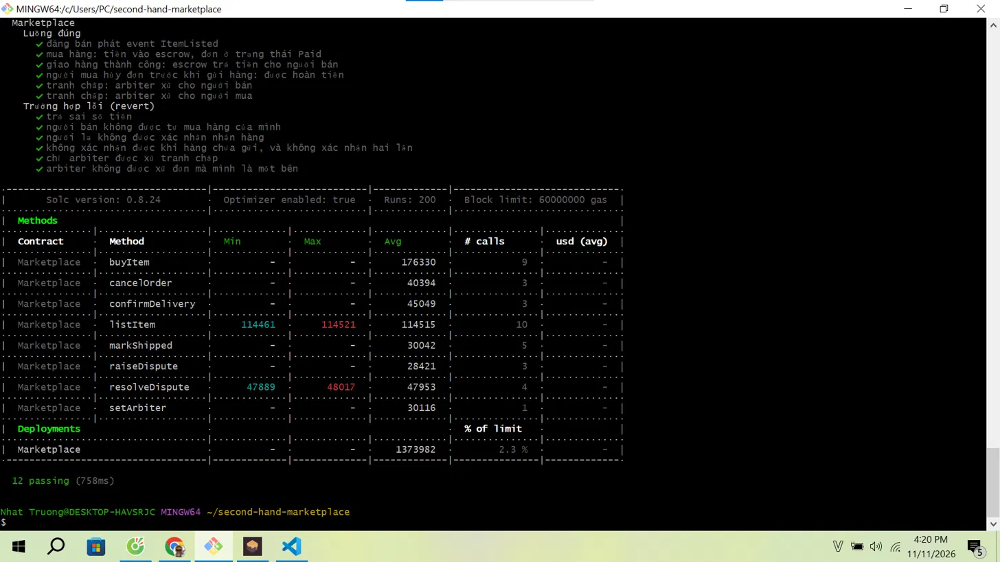
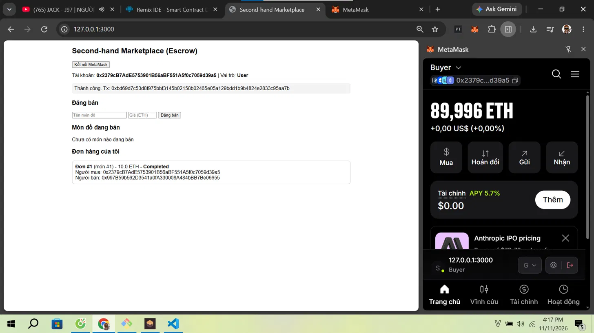
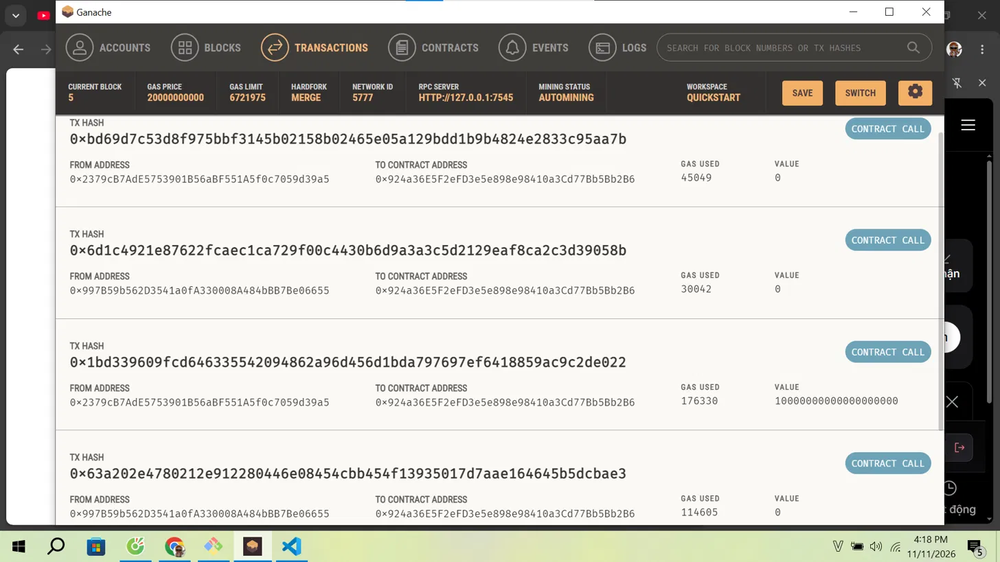

# Second-hand Marketplace with Escrow

A decentralized second-hand marketplace on Ethereum. Sellers list items, buyers pay into an **escrow contract**, and funds are released only when the buyer confirms delivery. If something goes wrong, an **arbiter** resolves the dispute. Order states are tracked with an `enum`.

**Team:** Nhat Truong (29211164915), _member 2_, 
**Course:** Blockchain, Duy Tan University

## Tech stack

- Solidity 0.8.24 (EVM target: paris)
- Hardhat + Chai/Ethers for compile, test and deploy
- Ganache (local blockchain, RPC `http://127.0.0.1:7545`, Chain ID 1337)
- HTML/JS front end with ethers.js v6 and MetaMask

## Project structure

```
second-hand-marketplace/
├── contracts/
│   ├── Escrow.sol          # holds ETH per order, only Marketplace can call it
│   └── Marketplace.sol     # items, orders, state machine, disputes
├── test/Marketplace.test.js
├── scripts/deploy.js       # deploys and writes frontend/contract.js
├── frontend/index.html     # web UI (contract.js is generated by deploy)
├── docs/images/            # screenshots used in this README
└── hardhat.config.js
```

## Design

### Roles

| Role | Who | Can do |
|---|---|---|
| Owner | Deployer | Change the arbiter (`setArbiter`) |
| Arbiter | Trusted third party | Resolve disputes (`resolveDispute`) |
| Seller | Any address | List/delist items, mark order as shipped |
| Buyer | Any address (not the seller) | Buy, cancel before shipping, confirm delivery, raise dispute |

### Contract diagram



### Order state machine (`enum OrderState`)



### Events

`ItemListed`, `ItemDelisted`, `OrderCreated`, `OrderShipped`, `OrderCompleted`, `OrderRefunded`, `DisputeRaised`, `DisputeResolved`, `ArbiterChanged` (Marketplace) and `Deposited`, `Released` (Escrow).

## Setup

Requirements: Node.js LTS, Ganache GUI, MetaMask.

```bash
git clone <repo-url>
cd second-hand-marketplace
npm install
npx hardhat compile
```

1. Start Ganache (QUICKSTART) on `http://127.0.0.1:7545`.
2. Run tests:
   ```bash
   npx hardhat test
   ```
3. Deploy to Ganache (Account 0 = owner, Account 1 = arbiter):
   ```bash
   npx hardhat run scripts/deploy.js --network ganache
   ```
   This prints the Marketplace/Escrow addresses and writes `frontend/contract.js`.
4. Start the front end:
   ```bash
   npx http-server frontend -p 3000 -c-1
   ```
   Open http://127.0.0.1:3000.
5. MetaMask setup:
   - Add network: RPC `http://127.0.0.1:7545`, Chain ID `1337`, symbol `ETH`.
   - Import Ganache accounts by private key: index 1 = Arbiter, index 2 = Seller, index 3 = Buyer.
   - After switching account in MetaMask, press F5 on the page.

> Note: Ganache shows Network ID 5777, but its Chain ID is 1337. MetaMask needs the Chain ID.
> If Ganache is restarted, redeploy with step 3, since QUICKSTART loses all data.

> 📷 TODO: `docs/images/01_deploy_terminal.png` (terminal output of `npx hardhat run scripts/deploy.js --network ganache`)



## Test results

12 automated tests pass: 6 for the normal flow and 6 for failure cases (wrong payment, seller buying own item, non-buyer confirming, wrong state, non-arbiter resolving, arbiter being a party of the order).



## Demo on Ganache

### 1. Normal flow: list, buy, ship, confirm

> 📷 TODO: `docs/images/04_web_listed.png` (seller lists an item)





> 📷 TODO: `docs/images/07_ganache_accounts_before_after.png` (Accounts tab before buying and after confirming: buyer decreases, seller increases)

### 2. Dispute flow

> 📷 TODO: `docs/images/08_web_disputed.png` (order in Disputed state)
> 📷 TODO: `docs/images/09_web_arbiter_resolve.png` (arbiter sees the two resolve buttons)
> 📷 TODO: `docs/images/10_web_dispute_resolved.png` (order ends as Completed or Refunded)

### 3. Failure cases (revert)

> 📷 TODO: `docs/images/11_web_revert_seller_cannot_buy.png` (error `SellerCannotBuy` shown in the status box)
> 📷 TODO: `docs/images/12_web_revert_not_buyer.png` (error `NotBuyer`)

### 4. Events

> 📷 TODO: `docs/images/13_events_output.png` (output of the event script or the Events tab)

## Gas analysis

Measured by hardhat-gas-reporter (optimizer on, 200 runs):

| Function | Avg gas |
|---|---|
| `listItem` | 114,515 |
| `buyItem` | 176,330 |
| `markShipped` | 30,042 |
| `confirmDelivery` | 45,049 |
| `cancelOrder` | 40,394 |
| `raiseDispute` | 28,421 |
| `resolveDispute` | 47,953 |
| `setArbiter` | 30,116 |
| Deployment (Marketplace + Escrow) | 1,373,982 |

### Optimization: struct packing

In `Order`, `buyer` (20 bytes), `state` (1 byte) and `createdAt` (`uint40`, 5 bytes) share one storage slot. An order takes 4 slots instead of 6, and each new storage slot costs about 20,000 gas on first write.

| `buyItem` | Gas |
|---|---|
| Without packing | _TODO: measure_ |
| With packing | 176,330 |

> 📷 TODO: `docs/images/14_gas_before_packing.png`

Other optimizations: custom errors instead of revert strings, `calldata` for string parameters, `immutable` for the Escrow address.

## Security considerations

- **Checks-Effects-Interactions:** state is updated before any ETH transfer (`Escrow.release`, `buyItem`).
- **Escrow isolation:** ETH sits in `Escrow`, and only `Marketplace` can call `deposit` and `release`.
- **Access control:** owner, arbiter, seller and buyer checks use custom errors. The arbiter cannot resolve an order they take part in.
- **State machine:** every action checks the current `OrderState`, so an order cannot be paid out twice.
- **Exact payment:** `buyItem` requires `msg.value == price`.
- **Front end:** item names are HTML-escaped to prevent XSS.
- **Limitations:** the arbiter is a centralized trust point, and there is no automatic timeout if the buyer never confirms (future work: auto-release after N days).

## Team contributions

| Member | Work |
|---|---|
| Nhat Truong | _fill in_ |
| Nguyen Van Nhan | _fill in_ |
