# BÁO CÁO ĐỒ ÁN BLOCKCHAIN

## SECOND-HAND MARKETPLACE WITH ESCROW — ReMarket

**Đề tài:** Xây dựng sàn giao dịch đồ cũ trên nền tảng Ethereum sử dụng hợp đồng thông minh và cơ chế ký quỹ Escrow  
**Học phần:** Blockchain — Đại học Duy Tân  
**Nhóm thực hiện:** Nhat Truong; Nguyen Van Nhan *(bổ sung MSSV và phân công chính thức trước khi nộp)*  
**Môi trường triển khai:** Ethereum local (Ganache), Hardhat, Solidity, MetaMask, ethers.js, HTML/CSS/JavaScript  
**Phạm vi báo cáo:** Mã nguồn và các minh chứng chạy thử do nhóm cung cấp, tháng 11/2026

> **Lưu ý về minh chứng:** Hình 01–13 bên dưới là 13 ảnh thực tế của nhóm, đã được đổi tên theo đúng nội dung quan sát. Hình 01 cho thấy web server hoạt động chứ **không** phải kết quả Hardhat test. Các ảnh không chứng minh riêng số lượng test pass hay số gas trung bình. Phần kiểm thử và gas cần bổ sung ảnh chụp terminal để hoàn thiện kết quả thực nghiệm.

---

## 1. Giới thiệu đề tài

### 1.1. Bối cảnh

Trong mua bán đồ cũ trực tuyến, người mua có thể lo lắng về việc trả tiền trước nhưng không nhận được hàng; ngược lại, người bán cần một cơ chế xác nhận thanh toán và hạn chế tranh chấp. Đồ án xây dựng một nguyên mẫu sàn giao dịch đồ cũ sử dụng hợp đồng thông minh (smart contract) trên một mạng Ethereum cục bộ. Smart contract lưu trạng thái sản phẩm và đơn hàng, thực thi quy tắc nhận và giải ngân ETH thử nghiệm.

### 1.2. Mục tiêu

- Cho phép **Seller** đăng/gỡ sản phẩm và đánh dấu đã gửi hàng.
- Cho phép **Buyer** mua hàng bằng ETH, hủy đơn trước khi giao, xác nhận nhận hàng hoặc tạo tranh chấp.
- Dùng **Escrow** để giữ ETH trong thời gian chờ kết quả đơn hàng; tiền không chuyển thẳng cho Seller lúc mua.
- Cho phép **Arbiter** phân xử tranh chấp, quyết định giải ngân cho Seller hoặc hoàn tiền Buyer.
- Kiểm tra phân quyền và luồng trạng thái bằng bộ test Hardhat; minh họa giao dịch và xác nhận ví bằng MetaMask/Ganache.

### 1.3. Phạm vi và giới hạn

Đây là hệ thống thử nghiệm trên **Ganache**, sử dụng ETH mô phỏng, không phải nền tảng giao dịch thương mại thực tế. Hợp đồng hiện lưu tên, giá, người bán, người mua và trạng thái; **chưa** có upload ảnh hàng thật, vận đơn, kiểm chứng giao nhận ngoài đời, cơ chế đánh giá hoặc xử lý tranh chấp dựa trên bằng chứng tự động. Arbiter vẫn là một điểm tin cậy tập trung.

## 2. Công nghệ và kiến trúc

| Công nghệ | Vai trò trong hệ thống |
|---|---|
| Solidity 0.8.24 | Biên dịch hợp đồng `Marketplace.sol`, `Escrow.sol` (pragma `^0.8.20`; Hardhat cấu hình 0.8.24) |
| Hardhat + Chai / ethers | Compile, deploy, viết và chạy unit test; báo cáo gas nếu cấu hình được bật |
| Ganache GUI | Blockchain Ethereum thử nghiệm cục bộ; RPC `http://127.0.0.1:7545`, Chain ID `1337` |
| MetaMask | Quản lý ví thử nghiệm và ký giao dịch từ trình duyệt |
| HTML, CSS, JavaScript, ethers.js v6 | Giao diện ReMarket, đọc contract, hiển thị và gửi giao dịch |
| Truffle | Dự án có `truffle-config.js`; phần deploy và test chính được minh chứng bằng **Hardhat**, không khẳng định đã chạy bộ test Truffle |

### 2.1. Luồng tương tác

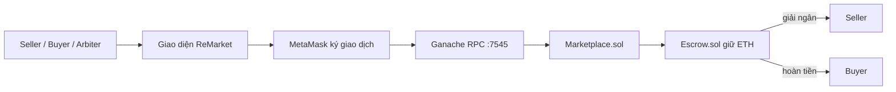

`Marketplace.sol` lưu sản phẩm, đơn hàng, vai trò, trạng thái và sự kiện. Khi triển khai `Marketplace`, constructor tạo một hợp đồng `Escrow` mới; địa chỉ Escrow có thể lấy bằng `market.escrow()`. Chỉ `Marketplace` mới được gọi `deposit()` và `release()` của Escrow. File `scripts/deploy.js` đồng thời tạo `frontend/contract.js` gồm địa chỉ Marketplace và ABI mới để frontend sử dụng.

### 2.2. Cấu trúc mã nguồn

```text
second-hand-marketplace/
├── contracts/
│   ├── Marketplace.sol
│   └── Escrow.sol
├── scripts/deploy.js
├── test/Marketplace.test.js
├── frontend/
│   ├── index.html
│   └── contract.js       # Được script deploy sinh/cập nhật
├── hardhat.config.js
├── truffle-config.js
├── package.json
└── docs/images/         # 13 ảnh minh chứng đã đổi tên
```

## 3. Phân tích vai trò và chức năng

| Vai trò | Ví Ganache demo | Chức năng được phép |
|---|---|---|
| **Owner / Arbiter** | Index 0: `0x49993A9D727C9293a195c5255ADE6f1B3993860d` | Owner gọi `setArbiter`; Arbiter gọi `resolveDispute` khi đơn bị tranh chấp và không phải người mua/bán của đơn |
| **Seller** | Index 1: `0x670b3dC303fcA1DDf669BD40Ca035ebd4292FC94` | `listItem`, `delistItem`, `markShipped`; có thể `raiseDispute` nếu là bên của đơn |
| **Buyer** | Index 2: `0x9Ca7486676CEB18A6b9EB346fB4222a3E034F649` | `buyItem`, `cancelOrder`, `confirmDelivery`, `raiseDispute` |

Địa chỉ trên chỉ là **địa chỉ công khai dùng để nhận diện ví test**. Không đưa private key hay mnemonic vào mã nguồn, báo cáo hoặc GitHub. Cùng một địa chỉ có thể có nhiều quyền nếu người triển khai cấu hình như vậy; ở demo, Index 0 đồng thời là Owner và Arbiter.

### 3.1. Các hàm chính

| Hàm | Người gọi | Điều kiện / kết quả |
|---|---|---|
| `listItem(name, price)` | Seller | Tên không rỗng, giá lớn hơn 0; thêm sản phẩm, phát `ItemListed` |
| `delistItem(itemId)` | Seller của sản phẩm | Sản phẩm còn active; phát `ItemDelisted` |
| `buyItem(itemId)` | Buyer khác Seller | Sản phẩm còn bán, thanh toán đúng giá; chuyển sang `Paid`, nạp ETH vào Escrow |
| `markShipped(orderId)` | Seller của đơn | Chỉ khi `Paid`; chuyển `Shipped` |
| `cancelOrder(orderId)` | Buyer của đơn | Chỉ khi `Paid`; chuyển `Refunded`, hoàn ETH cho Buyer |
| `confirmDelivery(orderId)` | Buyer của đơn | Chỉ khi `Shipped`; chuyển `Completed`, giải ngân cho Seller |
| `raiseDispute(orderId)` | Buyer hoặc Seller của đơn | Chỉ khi `Shipped`; chuyển `Disputed` |
| `resolveDispute(orderId, payoutToSeller)` | Arbiter | Chỉ khi `Disputed`, Arbiter không là bên giao dịch; `true` giải ngân Seller, `false` hoàn Buyer |
| `setArbiter(newArbiter)` | Owner | Cập nhật địa chỉ Arbiter hợp lệ |

### 3.2. Máy trạng thái đơn hàng

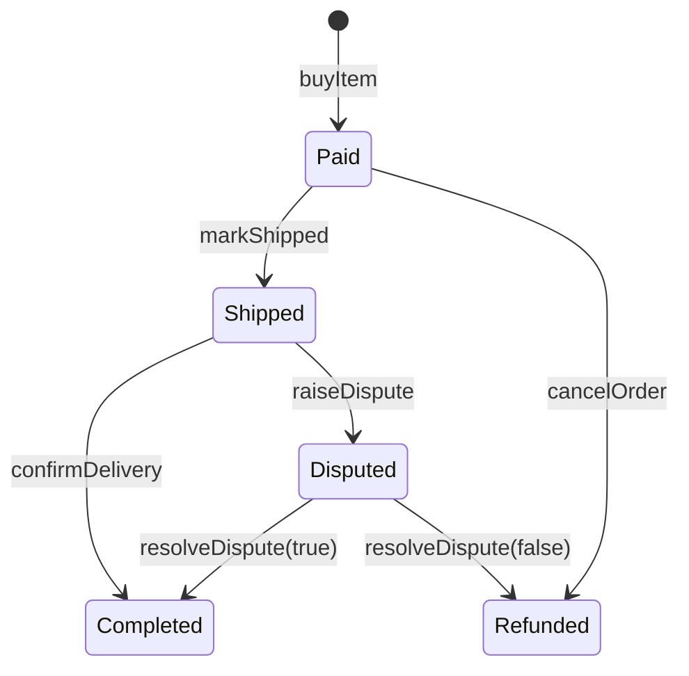

Các trạng thái `Completed` và `Refunded` là trạng thái kết thúc. Bộ kiểm tra quyền và trạng thái (`msg.sender`, `OrderState`) giới hạn người gọi và ngăn thực hiện nhầm chu trình hoặc thanh toán lặp.

## 4. Triển khai và cấu hình môi trường

### 4.1. Khởi tạo

Yêu cầu: Node.js tương thích Hardhat, Ganache GUI, MetaMask, dependencies trong `package.json`.

```powershell
cd C:\Users\PC\second-hand-marketplace
npm install
npx hardhat compile
npm test
```

Mở **workspace Ganache `SECONDHAND MARKET` đã lưu**, không nhấn Quick Start tạo một chain mới. Cấu hình RPC `http://127.0.0.1:7545`, Chain ID `1337`. MetaMask dùng cùng mạng và ba ví test phía trên.

### 4.2. Deploy smart contract (chỉ khi cần)

```powershell
npx hardhat run scripts/deploy.js --network ganache
```

Kết quả deploy đã được người thực hiện cung cấp trong lịch sử demo:

```text
Marketplace: 0xE5c97256832D0A7F3308a418d59847B02205672F
Escrow     : 0xF245977587daB15b1861Ff71a2499adC2f93F9DC
Arbiter    : 0x49993A9D727C9293a195c5255ADE6f1B3993860d
```

Đây là địa chỉ hợp đồng ở lần deploy đã ghi nhận, **không phải địa chỉ cố định cho mọi máy hoặc mọi lần chạy**. `deploy.js` ghi lại địa chỉ/ABI vào `frontend/contract.js`; deploy lại sẽ tạo hợp đồng mới, không đưa dữ liệu đơn hàng cũ sang hợp đồng mới. Vì vậy, nếu Ganache hiện còn hợp đồng đang hoạt động, không cần deploy lại chỉ để chạy web.

### 4.3. Mở web

```powershell
npm run web
```

Truy cập `http://127.0.0.1:3000`; nếu đã chạy server thì không khởi động cổng 3000 lần hai. Sau khi chuyển ví MetaMask, làm mới trang và xác nhận tên vai trò/địa chỉ/mạng đang hiển thị.

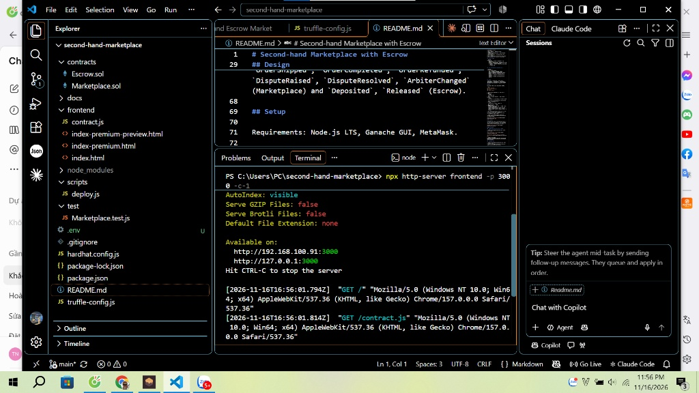

*Hình 01. Cấu trúc dự án trong VS Code và web server phục vụ giao diện qua cổng 3000. Ảnh này không phải kết quả test hoặc deploy.*

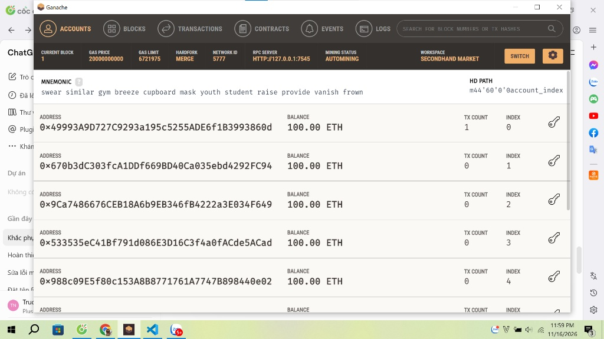

*Hình 02. Ganache workspace `SECONDHAND MARKET`, tài khoản test và số dư ETH mô phỏng. Network ID 5777 hiển thị trên Ganache không đồng nhất với Chain ID 1337 dùng trong MetaMask.*

## 5. Thực nghiệm các chức năng nghiệp vụ

### 5.1. Dữ liệu sản phẩm thực sự xuất hiện trong ảnh

Các tên và giá dưới đây **được chép từ ảnh chụp của nhóm**, không dùng bộ giá ví dụ ban đầu vì ảnh thể hiện giá khác:

| Đơn/sản phẩm trong ảnh | Giá ETH | Mục đích thực nghiệm |
|---|---:|---|
| Đơn #1 — iPhone 18 Pro | 0.2 | Mua, giao, xác nhận thành công |
| Đơn #2 — LapTop Dell | 0.3 | Buyer hủy trước giao, hoàn tiền |
| Đơn #3 — Samsung Galaxy | 0.5 | Tranh chấp, Arbiter xử cho Seller |
| Đơn #4 — Tai nghe Sony | 0.4 | Tranh chấp, Arbiter hoàn Buyer |

#### A. Luồng giao dịch thành công — Seller → Buyer → Seller → Buyer

**A1. Seller đăng bán.** Seller (Index 1) nhập tên và giá, bấm Đăng bán; lệnh `listItem()` ghi sản phẩm lên chuỗi. Giao diện hiển thị thẻ sản phẩm khi giao dịch được xác nhận.

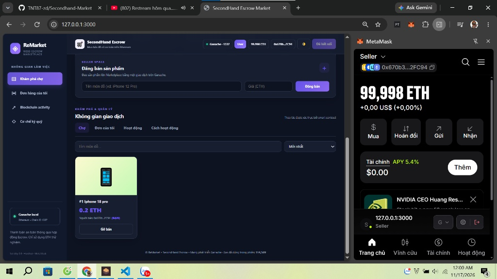

*Hình 03. Giao diện Seller, các sản phẩm được niêm yết ở khu vực Chợ.*

**A2. Buyer mua sản phẩm.** Buyer (Index 2) chọn món hàng, chấp thuận giao dịch qua MetaMask. `buyItem()` đòi đúng số tiền và gọi `Escrow.deposit()`; đơn hàng ở trạng thái `Paid`, tiền chưa chuyển cho Seller.

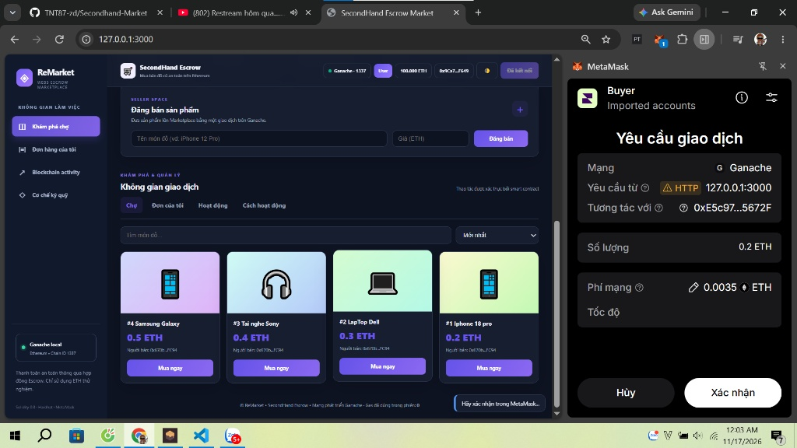

*Hình 04. MetaMask hiện hộp xác nhận giao dịch mua từ Buyer. Đây là ảnh ở bước xác nhận, không thay thế minh chứng block đã khai thác.*

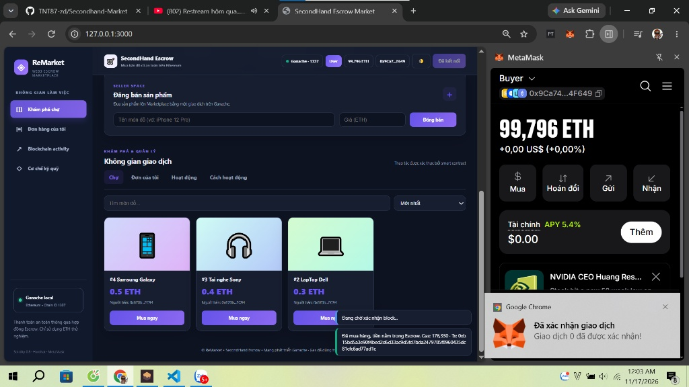

*Hình 05. Web hiển thị thông báo mua hàng/đã khóa ETH trong Escrow sau giao dịch, cùng MetaMask. Ảnh không mở chi tiết dòng `Paid`, nên trạng thái này được đối chiếu thêm từ luồng hợp đồng và ảnh tiếp theo.*

**A3. Seller đánh dấu gửi hàng.** Sau khi mua, Seller gọi `markShipped(orderId)`, chuyển đơn sang `Shipped`; chỉ Seller liên quan mới được thực hiện.

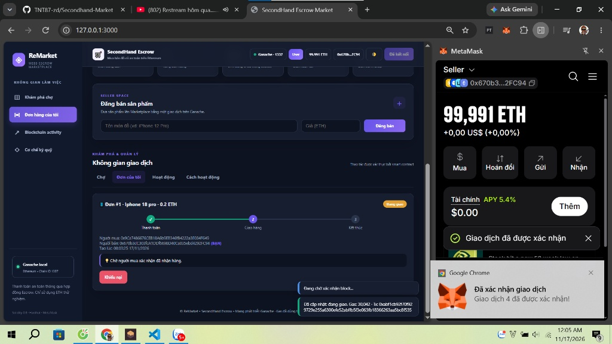

*Hình 06. Đơn #1 đang ở giai đoạn giao hàng; giao diện Seller hiển thị thông báo thành công và chờ Buyer xác nhận.*

**A4. Buyer xác nhận nhận hàng.** Buyer gọi `confirmDelivery(orderId)`; hợp đồng đặt trạng thái `Completed` và gọi `Escrow.release(orderId, seller)` để giải ngân.

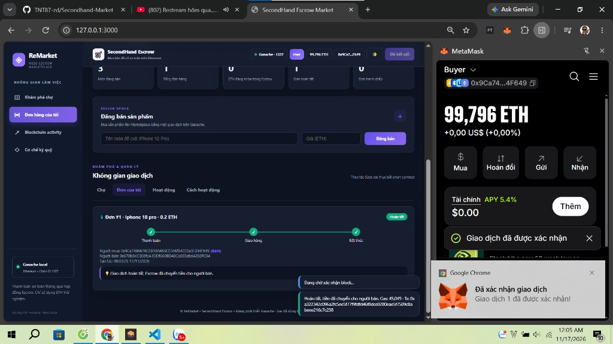

*Hình 07. Đơn #1 hiển thị Hoàn tất và thông báo Escrow chuyển ETH cho Seller.*

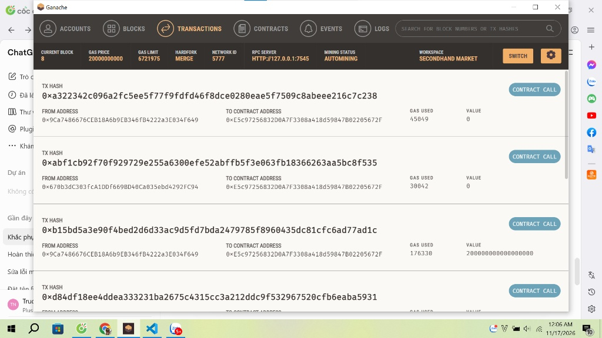

*Hình 08. Giao diện Ganache Transactions lưu dấu các giao dịch trên blockchain thử nghiệm; có thể mở từng transaction để đối chiếu hash, block và gas.*

> **Nhận xét:** Buyer trả số ETH bằng giá sản phẩm, đồng thời chi gas; Seller nhận khoản giải ngân khi điều kiện hoàn tất được đáp ứng, nhưng cũng tốn gas cho giao dịch đã thực hiện. Vì vậy, số dư ví trước/sau không nên so sánh chỉ bằng đúng giá hàng mà không xét phí giao dịch.

#### B. Buyer hủy đơn trước khi giao hàng

Buyer mua đơn #2 — **LapTop Dell, 0.3 ETH**; khi đơn còn ở trạng thái `Paid`, Buyer dùng `cancelOrder()` để hủy và nhận hoàn tiền. Hàm này không hợp lệ nếu Seller đã chuyển đơn sang `Shipped`.

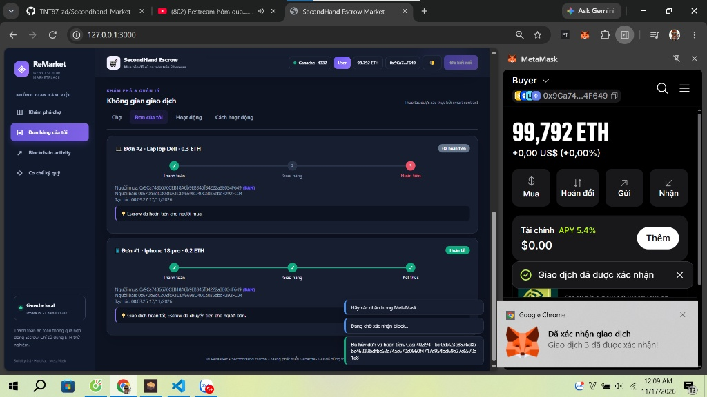

*Hình 09. Đơn #2 hiển thị Đã hoàn tiền và thông báo Escrow đã hoàn tiền cho Buyer.*

#### C. Tranh chấp: Arbiter xử cho Seller

Với đơn #3 — **Samsung Galaxy, 0.5 ETH**, Buyer thanh toán, Seller đã xác nhận gửi hàng và Buyer đưa đơn sang trạng thái `Disputed` bằng `raiseDispute()`.

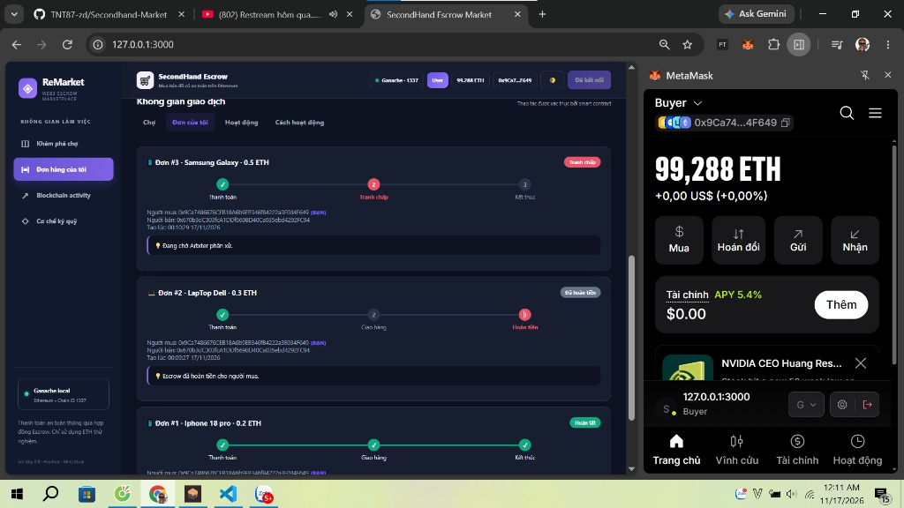

*Hình 10. Đơn #3 hiển thị trạng thái Tranh chấp, thông báo chờ Arbiter phân xử.*

Arbiter (Index 0) đăng nhập vào màn hình đơn hàng đang tranh chấp. Hệ thống hiển thị hai quyết định: trả tiền Seller hoặc hoàn Buyer. Với nhánh xử cho Seller, Arbiter ký `resolveDispute(orderId, true)`.

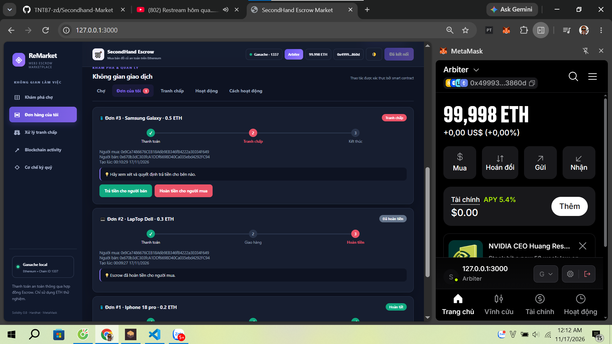

*Hình 11. Tài khoản Arbiter và hai nút Trả tiền cho người bán / Hoàn tiền cho người mua; đây là bằng chứng phân quyền giao diện.*

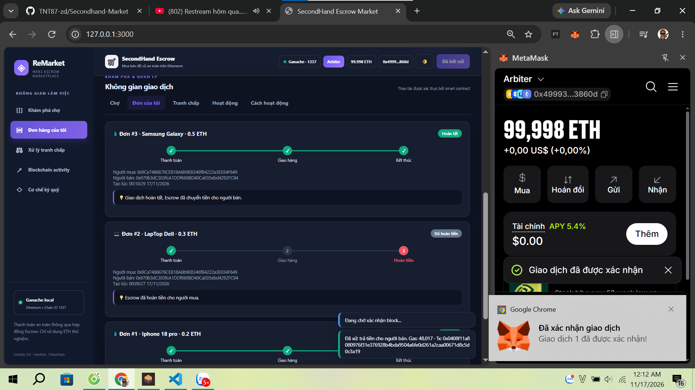

*Hình 12. Đơn #3 chuyển sang Hoàn tất, có thông báo giao dịch đã được xác nhận và Escrow chuyển ETH cho Seller.*

#### D. Tranh chấp: Arbiter hoàn tiền Buyer

Với đơn #4 — **Tai nghe Sony, 0.4 ETH**, sau khi đơn ở `Disputed`, Arbiter chọn hoàn Buyer bằng `resolveDispute(orderId, false)`. Hệ thống chuyển đơn sang `Refunded` và Escrow chuyển lại số ETH ký quỹ cho Buyer.


*Hình 13. Đơn #4 hiển thị Đã hoàn tiền; bên dưới có thông báo giao dịch chuyển trả ETH đã được xác nhận.*
### Kết quả kiểm thử Hardhat

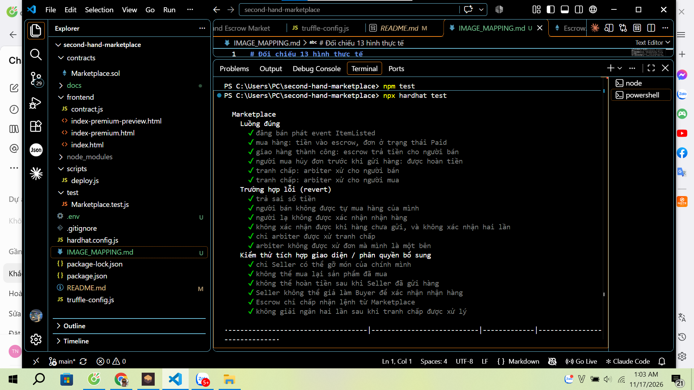

### Phân tích chi phí Gas


### 5.2. Tổng hợp thực nghiệm

| Tình huống | Trạng thái kết thúc quan sát | Ảnh liên quan |
|---|---|---|
| Người bán đăng sản phẩm và Buyer mua | Phát sinh giao dịch, ETH được giữ trong Escrow | 03–05, 08 |
| Seller giao hàng và Buyer xác nhận | `Completed`, Seller nhận ETH | 06–08 |
| Buyer hủy trước giao hàng | `Refunded`, Buyer nhận lại ETH | 09 |
| Tranh chấp và Arbiter xử cho Seller | `Completed` | 10–12 |
| Tranh chấp và Arbiter xử cho Buyer | `Refunded` | 13 |

## 6. Kiểm thử bằng Hardhat

Trong bản source tích hợp `test/Marketplace.test.js` có **18 trường hợp `it(...)` được khai báo**. Đây là số lượng trường hợp kiểm thử trong mã; báo cáo này **không khẳng định 18/18 passed** vì bộ 13 ảnh hiện không có kết quả lệnh `npm test`.

Các nhóm test gồm:

1. **Luồng nghiệp vụ:** đăng sản phẩm, mua và gửi ETH vào escrow, giao hàng, Buyer xác nhận, Buyer hủy, Arbiter xử cho mỗi bên.
2. **Sai điều kiện/phân quyền:** sai giá; Seller mua chính món của mình; sai Buyer/Seller; đơn chưa giao; sai Arbiter; Arbiter là một bên tranh chấp.
3. **Tính toàn vẹn:** sản phẩm đã gỡ/đã bán không mua lại; không hoàn sau khi giao; Escrow chỉ nhận lời gọi từ Marketplace; ngăn giải ngân lặp.

Chạy tại thư mục dự án:

```powershell
npm test
```

**[CẦN BỔ SUNG MINH CHỨNG]** Chụp terminal hiển thị `passing` và tên test; lưu thành `docs/images/14_ket_qua_hardhat_test.png`. Sau khi có ảnh và kết quả thực tế, cập nhật dòng “X/Y passing” vào báo cáo. `npm test` mặc định chạy Hardhat Network kiểm thử riêng, không thay thế việc xác thực giao dịch MetaMask trên Ganache.

### 6.1. Bảo mật và kiểm soát trạng thái

- **Phân quyền:** kiểm tra `msg.sender` với chủ thể của đơn và Arbiter; thông báo lỗi bằng custom error (`NotSeller`, `NotBuyer`, `NotArbiter`, `WrongState`, ...).
- **Đúng giá:** `buyItem()` yêu cầu `msg.value == price` (`WrongPayment`).
- **Chống trả hai lần:** `Escrow.release()` đặt `deposits[orderId] = 0` trước khi chuyển ETH; trạng thái đơn kết thúc không cho gọi giải ngân lần nữa.
- **Cô lập Escrow:** chỉ địa chỉ Marketplace được gọi `Escrow.deposit/release` qua modifier `onlyMarketplace`.
- **Tranh chấp:** Arbiter không thể xử một đơn mà họ chính là Buyer hoặc Seller.
- **Giới hạn:** chưa có timeout tự động, chưa kiểm chứng giao hàng ngoài chuỗi, Arbiter là bên ra quyết định tin cậy.

### 6.2. Các event được phát

Marketplace: `ItemListed`, `ItemDelisted`, `OrderCreated`, `OrderShipped`, `OrderCompleted`, `OrderRefunded`, `DisputeRaised`, `DisputeResolved`, `ArbiterChanged`.  
Escrow: `Deposited`, `Released`.

Các event cung cấp nhật ký nghiệp vụ trên chain; ảnh Ganache Transactions (Hình 08) cho thấy có giao dịch, **không thay thế** bằng chứng lọc event log cụ thể nếu thầy yêu cầu truy vấn log.

## 7. Gas và tối ưu hợp đồng

Hardhat cấu hình optimizer bật, 200 runs, EVM `paris`, gas reporter được bật. Các số liệu cũ từng được ghi trong README trước (ví dụ `buyItem` khoảng 176,330 gas) là **số liệu tham khảo chưa đối chứng bằng ảnh test trong bộ tài liệu mới**, nên chưa dùng để kết luận tiết kiệm bao nhiêu %.

Hợp đồng đã sử dụng các kỹ thuật thiết kế có thể giảm chi phí hoặc giúp kiểm soát code:

- `Order` xếp `buyer` (20 byte), `state` (enum), `createdAt` (`uint40`) cạnh nhau để hỗ trợ storage packing.
- Dùng `custom error` cho các trường hợp revert, `calldata` cho tên sản phẩm trong `listItem` và `immutable` cho địa chỉ Escrow.
- Duy trì trạng thái đơn và số dư `deposits` để giảm nguy cơ chuyển tiền sai/lặp.

**[CẦN BỔ SUNG MINH CHỨNG]** Chạy `npm test` và chụp bảng gas report vào `docs/images/15_bang_gas_hardhat.png` (nếu có). Không báo cáo số gas “trước tối ưu” khi chưa có một phiên bản so sánh được đo với cùng điều kiện.

## 8. Đánh giá kết quả, hạn chế và hướng phát triển

### 8.1. Kết quả

Các ảnh demo ghi nhận được những chức năng cốt lõi: niêm yết, mua hàng bằng ETH test, chuyển trạng thái giao hàng, xác nhận hoàn tất, hủy đơn trước giao, tranh chấp và Arbiter quyết định chuyển tiền cho từng bên. Hệ thống sử dụng smart contract để quy định khi nào Escrow được giữ hoặc giải ngân tiền, thay vì dùng một tài khoản trung gian quản lý trực tiếp.

### 8.2. Hạn chế

- Chỉ thử trên blockchain local Ganache; chưa triển khai/đánh giá phí và độ ổn định trên public testnet.
- Hình sản phẩm đang là biểu tượng minh họa, chưa có kho ảnh/metadata phi tập trung như IPFS.
- Chưa có cơ chế bằng chứng giao nhận hoặc xác thực danh tính bên ngoài blockchain.
- Arbiter là điểm tin cậy tập trung; không tự động phân xử theo dữ liệu thực tế.
- Chưa có chính sách thời hạn hủy/xác nhận tự động, cơ chế vận chuyển hay đánh giá người bán.

### 8.3. Hướng phát triển

Bổ sung metadata và ảnh qua IPFS; đưa hệ thống lên testnet; hoàn thiện bộ lọc sản phẩm và lịch sử giao dịch; bổ sung bằng chứng vận chuyển, thời hạn xử lý, cơ chế phân xử nhiều Arbiter hoặc bỏ phiếu và các bài thử bảo mật chuyên sâu.

## 9. Kết luận

Đồ án minh họa được giá trị của Ethereum smart contract trong việc **quản lý trạng thái đơn hàng và tự động thực thi điều kiện ký quỹ**, giúp người mua và người bán có một quy trình giao dịch dễ kiểm chứng trên mạng thử nghiệm. Qua các kịch bản hoàn tất, hủy đơn và tranh chấp, nhóm thể hiện được vai trò của Seller, Buyer, Arbiter cũng như sự phối hợp giữa Marketplace và Escrow. Để hướng tới ứng dụng thực tế, hệ thống cần bổ sung hạ tầng ngoài chuỗi, xử lý rủi ro giao hàng và kiểm thử trên môi trường công khai.

## 10. Thông tin nhóm và minh chứng cần hoàn thiện trước khi nộp

| Nội dung | Trạng thái |
|---|---|
| 13 ảnh nghiệp vụ chụp từ hệ thống | **Đã đính kèm; đã đặt lại tên và ghi chú đúng** |
| Ảnh `npm test` thực tế | **Chưa có trong ZIP ảnh; cần chụp** |
| Ảnh báo cáo gas Hardhat | **Chưa có trong ZIP ảnh; cần chụp nếu trình bày gas** |
| MSSV thành viên và phân công nhiệm vụ | **Cần nhóm xác nhận trước khi công bố** |
| Link repository của chính đồ án SecondHand | **Cần thêm link đúng vào README** |

**Phân công thành viên — điền theo đúng công việc đã thực hiện:**

| Thành viên | MSSV | Đóng góp đã xác nhận |
|---|---|---|
| Nhat Truong | 29211164915 *(theo README nhóm gửi, vui lòng kiểm tra)* | *Chưa điền — nhóm xác nhận* |
| Nguyen Van Nhan | *Chưa cung cấp* | *Chưa điền — nhóm xác nhận* |

---

### Phụ lục A — Chạy nhanh để thuyết trình

1. Mở Ganache workspace `SECONDHAND MARKET`, xác nhận chain, RPC và hợp đồng còn bytecode.
2. `npm run web` → mở website 3000 → MetaMask chọn Seller/Buyer/Arbiter tùy màn demo.
3. Giữ những đơn đã thực nghiệm để **giải thích trạng thái ngay trên màn hình** mà không cần tạo lại vào phút cuối.
4. Nếu muốn chạy lại một luồng mới, tạo sản phẩm mới; không reset blockchain và không deploy lại khi chưa cần.
5. Chuẩn bị sẵn Hình 01–13 và ảnh `npm test` bổ sung để thầy đối chiếu.

### Phụ lục B — Tên hình đã hiệu chỉnh

Danh sách đối chiếu tên cũ và tên mới đầy đủ có trong `IMAGE_MAPPING.md` tại thư mục gốc của bộ tài liệu này.
